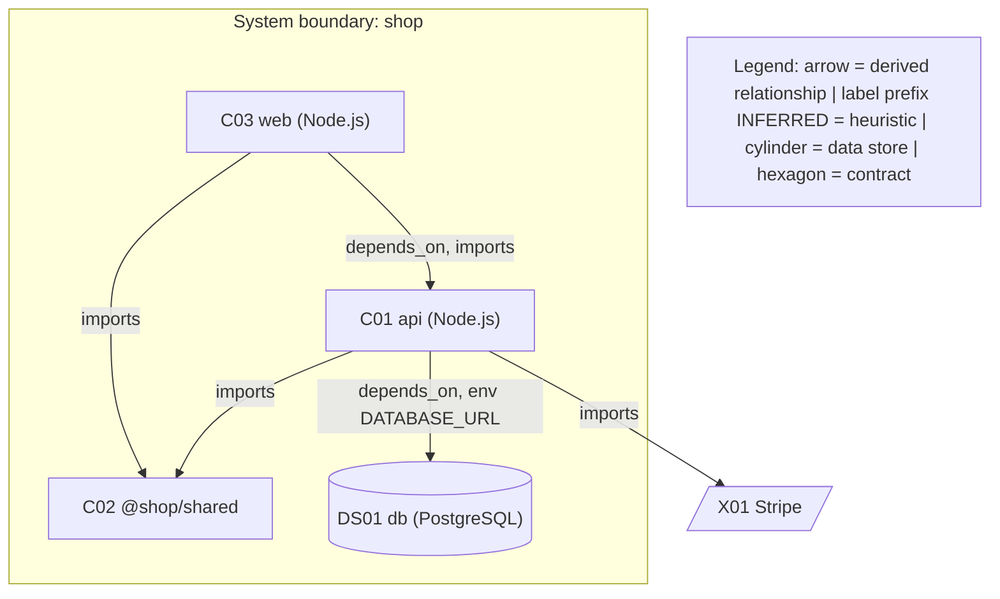
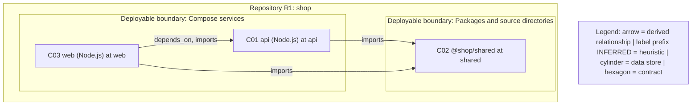
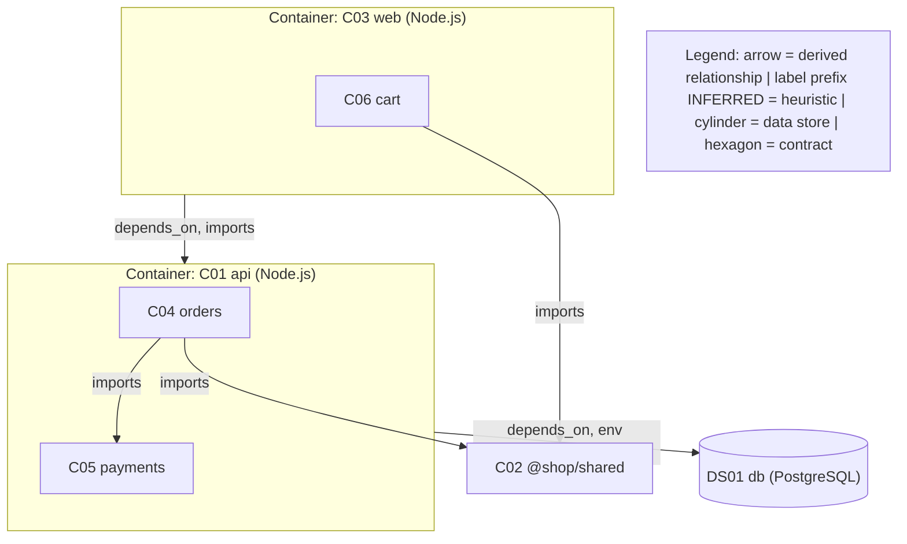
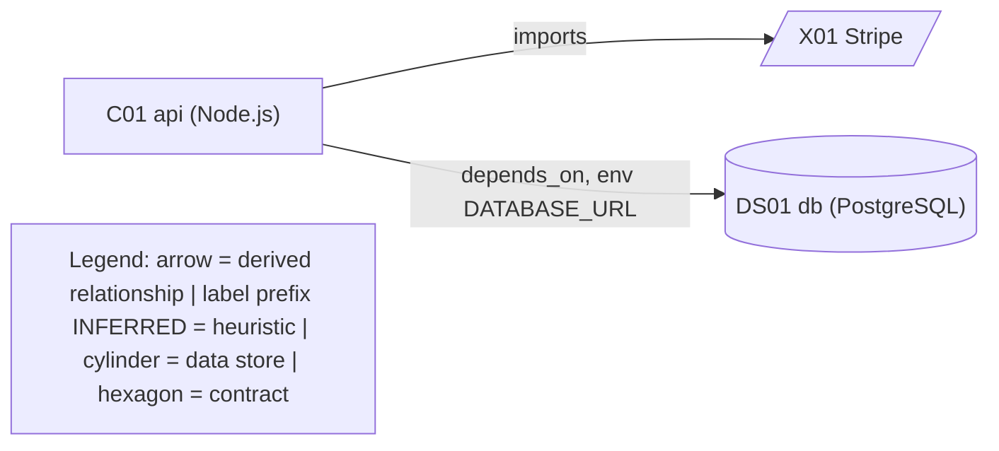
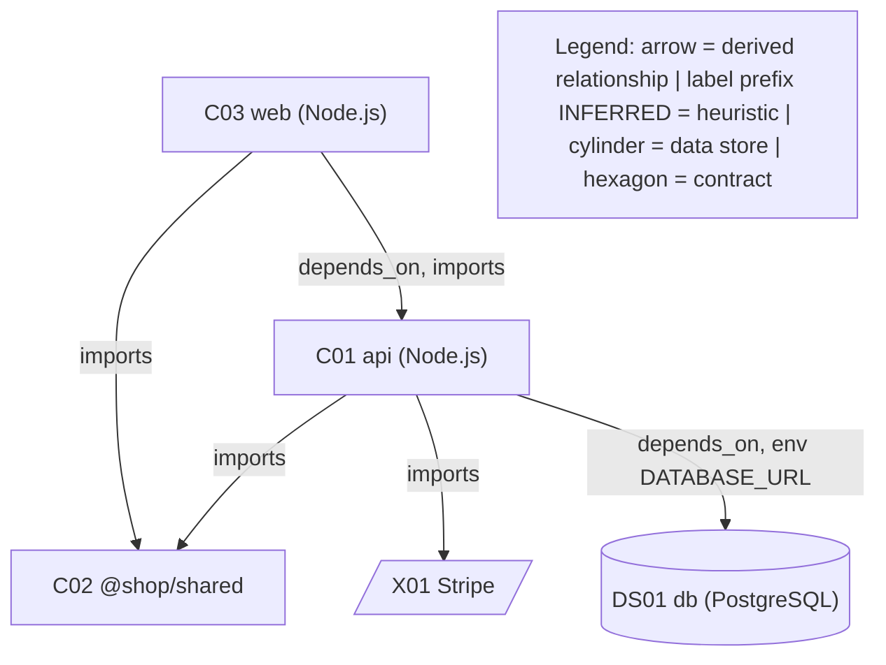
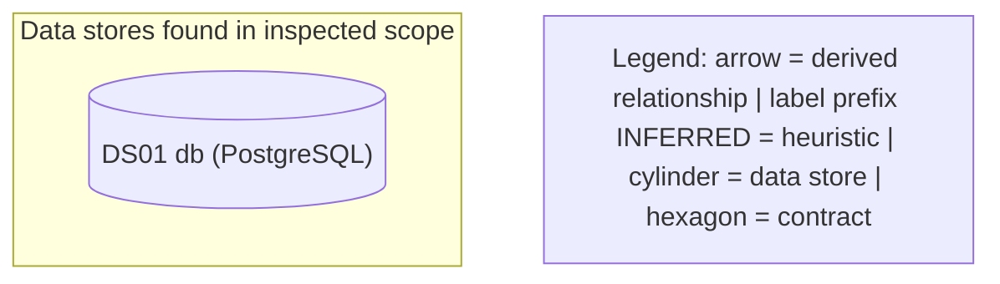
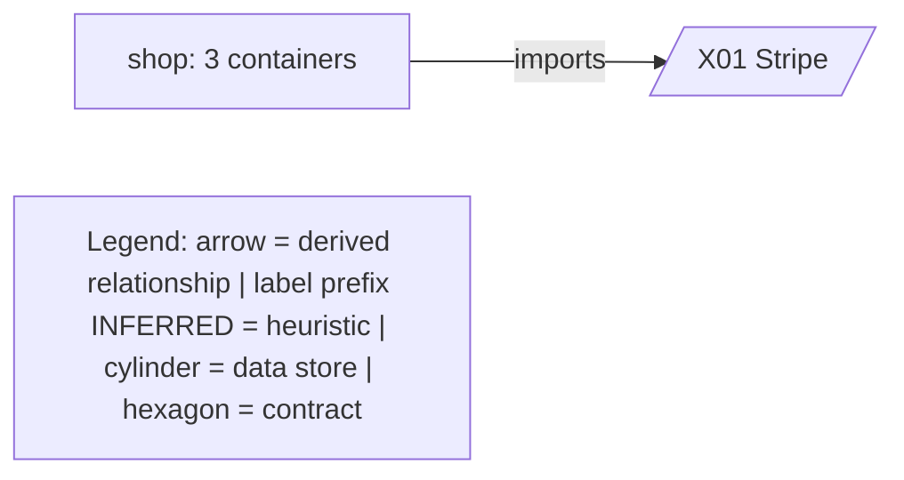
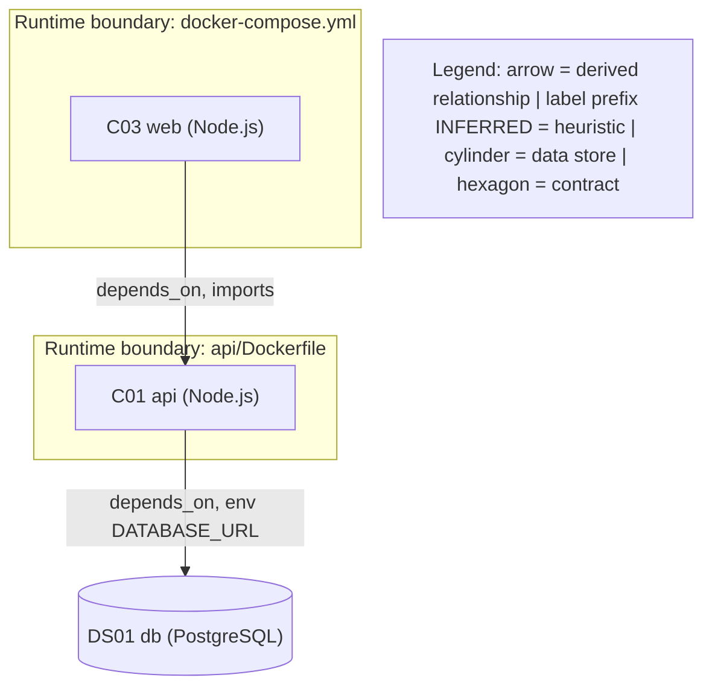
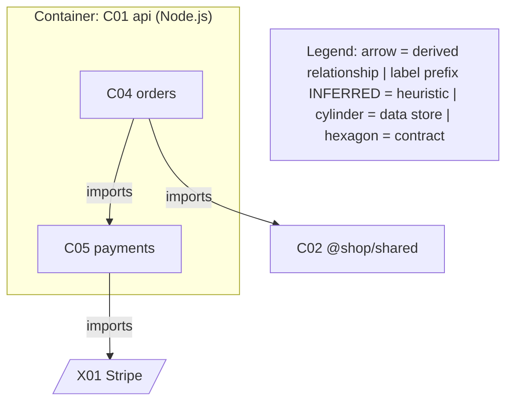
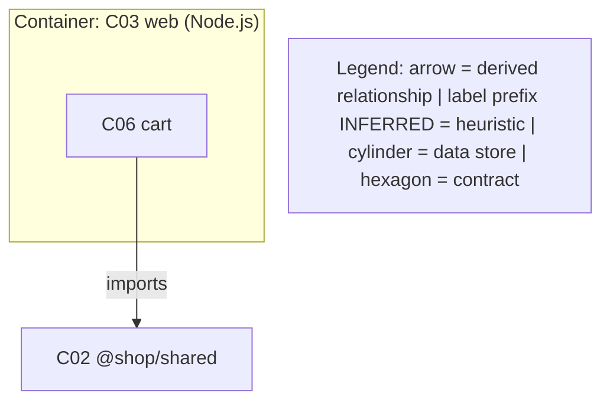

# shop: as-built architecture blueprint

**Overall status:** PROVISIONAL · **Snapshot:** unknown · **Generated:** 2026-01-01 by Blueprint Check 0.1.0 · **Basis:** static, deterministic derivation

This blueprint is generated from evidence that Architecture Check, the Impact Check module graph found in the repository. Views that need judgment (journeys, trust enforcement, operations) are marked blocked, not invented. IDs resolve in `architecture-model.json`; evidence ids in `evidence-register.json`.

## 1. Survey

| Input | Used | Detail |
|---|---|---|
| Architecture Check derive | yes | `0.2.1, config defaults` |
| Impact Check module graph | yes | `/Users/rkoushik/Documents/GitHub Repos/crewpe-engineering-commons/blueprint-check/examples/demo/graph.json` |
| Product Check surface | no | endpoints, pages, entities not derived |

Derived: 3 containers · 3 components · 1 external systems · 1 data stores · 0 contracts · 6 relationships · 17 evidence records.

## 2. Views

### D00 Master software blueprint

**Status:** produced. From the as-built model.

Source: [diagrams/D00.mmd](diagrams/D00.mmd)

### D01 Repository and deployable map

**Status:** produced. Containers grouped by how they are declared (compose, Kubernetes, Dockerfile, package).

Source: [diagrams/D01.mmd](diagrams/D01.mmd)

### D02 Application floor plan

**Status:** produced. Containers with module-graph components.

Source: [diagrams/D02.mmd](diagrams/D02.mmd)

### D03 User and request flow

**Status:** blocked. Request flows need traced journeys. Needs a person or an agent: static derivation cannot select or trace this without inventing it. Gap recorded.

### D04 Data plumbing

**Status:** partial. Store and integration edges are shown; reads versus writes and transformations are not derived.

Source: [diagrams/D04.mmd](diagrams/D04.mmd)

### D05 API and event wiring

**Status:** produced. Derived relationships plus API descriptions and discovered endpoints. Queues, pub/sub and webhooks are not detected by the inputs.

Source: [diagrams/D05.mmd](diagrams/D05.mmd)

### D06 Authentication and security flow

**Status:** blocked. No auth surface in the inputs. Needs a person or an agent: static derivation cannot select or trace this without inventing it. Gap recorded.

### D07 Database and storage blueprint

**Status:** produced. Database containers and declared entities.

Source: [diagrams/D07.mmd](diagrams/D07.mmd)

### D08 Background processing

**Status:** blocked. Schedulers, queues and workers are not detected by the inputs. Needs a person or an agent: static derivation cannot select or trace this without inventing it. Gap recorded.

### D09 External integrations site plan

**Status:** produced. External systems from SDK imports and Product Check integrations.

Source: [diagrams/D09.mmd](diagrams/D09.mmd)

### D10 Deployment and runtime blueprint

**Status:** produced. Compose, Kubernetes and Dockerfile declarations; not proof of production deployment.

Source: [diagrams/D10.mmd](diagrams/D10.mmd)

### D11 Domain and component detail

**Status:** produced. One view per container with components.

**D11-C01: Component detail: api**

Source: [diagrams/D11-C01.mmd](diagrams/D11-C01.mmd)

**D11-C03: Component detail: web**

Source: [diagrams/D11-C03.mmd](diagrams/D11-C03.mmd)

### D12 Critical journey sequences

**Status:** blocked. Critical journeys are not derived. Needs a person or an agent: static derivation cannot select or trace this without inventing it. Gap recorded.

### D13 Build, release and supply path

**Status:** blocked. CI and release definitions are not modelled by the inputs. Needs a person or an agent: static derivation cannot select or trace this without inventing it. Gap recorded.

### D14 Configuration, environments and feature variants

**Status:** blocked. Configuration precedence is not derived. Needs a person or an agent: static derivation cannot select or trace this without inventing it. Gap recorded.

### D15 Observability and operational control

**Status:** blocked. Telemetry wiring is not derived. Needs a person or an agent: static derivation cannot select or trace this without inventing it. Gap recorded.

### D16 Resilience and failure paths

**Status:** blocked. Timeouts, retries and recovery are not derived. Needs a person or an agent: static derivation cannot select or trace this without inventing it. Gap recorded.

### D17 AI, agent and retrieval blueprint

**Status:** not_applicable. No AI SDK import found by Architecture Check's vendor map (not proof of absence).

### D18 Tenancy and data isolation

**Status:** blocked. Tenancy is not evidenced or refuted by the inputs. Needs a person or an agent: static derivation cannot select or trace this without inventing it. Gap recorded.

## 3. Elements

| ID | Name | Kind | Implementation | Evidence | Confidence |
|---|---|---|---|---|---|
| C01 | api | container | `api` | `E002` `api/Dockerfile:L1`; `E003` `docker-compose.yml:L6` | CONFIRMED |
| C02 | @​shop/shared | container | `shared` | `E004` `shared/package.json:L1` | CONFIRMED |
| C03 | web | container | `web` | `E005` `docker-compose.yml:L2`; `E006` `web/Dockerfile:L1` | CONFIRMED |
| C04 | orders | component | `api/src/orders` | `E007` `api/src/orders` | CONFIRMED |
| C05 | payments | component | `api/src/payments` | `E008` `api/src/payments` | CONFIRMED |
| C06 | cart | component | `web/src/cart` | `E009` `web/src/cart` | CONFIRMED |
| X01 | Stripe | external_system | n/a | `E010` `api/src/payments/stripe.ts:L1` | CORROBORATED |
| DS01 | db | data store | n/a | `E001` `docker-compose.yml:L12` | CONFIRMED |

## 4. Relationships

| ID | From | To | Purpose | Evidence | Confidence |
|---|---|---|---|---|---|
| REL01 | C04 | C05 | imports | `E011` `api/src/orders/service.ts:L2` | CONFIRMED |
| REL02 | C04 | C02 | imports | `E012` `api/src/orders/service.ts:L1` | CONFIRMED |
| REL03 | C05 | X01 | imports | `E010` `api/src/payments/stripe.ts:L1` | CONFIRMED |
| REL04 | C01 | DS01 | depends\_on, env DATABASE\_URL | `E013` `docker-compose.yml:L9`; `E014` `docker-compose.yml:L11` | CONFIRMED |
| REL05 | C06 | C02 | imports | `E015` `web/src/cart/cart.ts:L1` | CONFIRMED |
| REL06 | C03 | C01 | depends\_on, imports | `E016` `docker-compose.yml:L5`; `E017` `web/src/app.ts:L1` | CONFIRMED |

## 6. Observations

No rule-based observation applies.

## 7. Coverage

| Metric | Numerator | Denominator | Percent | Note |
|---|---|---|---|---|
| repository_access | 1 | 1 | 100% | One repository per run. |
| architectural_unit_inspection | 3 | 4 | 75% | partially\_inspected=0, enumerated\_only=1, excluded=0 |
| component_representation | 8 | 8 | 100% | Elements beyond a view's node budget count only if another view draws them. |
| material_edge_verification | 6 | 6 | 100% | CORROBORATED=0, INFERRED=0 |
| critical_journey_tracing | 0 | 0 | n/a | Not derived; journeys need a person or an agent (gap journeys-not-derived). |
| blueprint_view_assessment | 19 | 19 | 100% | Every view has produced, partial, blocked or not\_applicable with a reason. |
| diagram_parser_validation | 0 | 0 | n/a | Not run: Blueprint Check bundles no Mermaid parser (structural lint only; see V09). |

Denominators are bounded by what the input tools discovered in one repository; undiscovered elements may remain. Metrics are never combined into a score.

## 8. Validation

| Gate | Check | Status | Evidence |
|---|---|---|---|
| V01 | Scope integrity | pass | R1 at unknown commit; dirty state not determined |
| V02 | Inventory completeness | pass | Enumeration is never counted as inspection |
| V03 | Source traceability | pass | 17 records, 0 with a line that could not be hashed |
| V04 | Critical journeys | not_run | Gap journeys-not-derived |
| V05 | Cross-repository contracts | not_run | Generate one blueprint per repository; cross-repository bindings need a person or an agent |
| V06 | As-built accuracy | pass | 0 INFERRED relationships labelled in views |
| V07 | Cross-view consistency | pass | All references resolve |
| V08 | Catalog coverage | pass | D00=produced, D01=produced, D02=produced, D03=blocked, D04=partial, D05=produced, D06=blocked, D07=produced, D08=blocked, D09=produced, D10=produced, D11=produced, D12=blocked, D13=blocked, D14=blocked, D15=blocked, D16=blocked, D17=not\_applicable, D18=blocked |
| V09 | Mermaid validation | not_run | Structural lint clean for 10 diagrams |
| V10 | Rendered readability | not_run | Node budget 22 per view; omitted elements are counted |
| V11 | Machine-readable integrity | pass | No problems |
| V12 | Coverage honesty | pass | See coverage-ledger.json |
| V13 | Sensitive data and source preservation | pass | Redaction applied to all documents and labels |

## 9. Hand-off to Architecture Check

`workspace.dsl` in this folder is the as-built model in Structurizr DSL. Review it, keep what is intended, and commit it as `architecture/workspace.dsl`. From then on `architecture-check check` reports every change in the code that the model does not describe, and `blueprint-check check` reports when this blueprint's evidence goes stale.

---

Generated by [Blueprint Check](https://github.com/enwithai/blueprint-check), part of the EnWithAI Engineering Commons (MIT). Deterministic and offline: no code executed, no network, no AI model.
